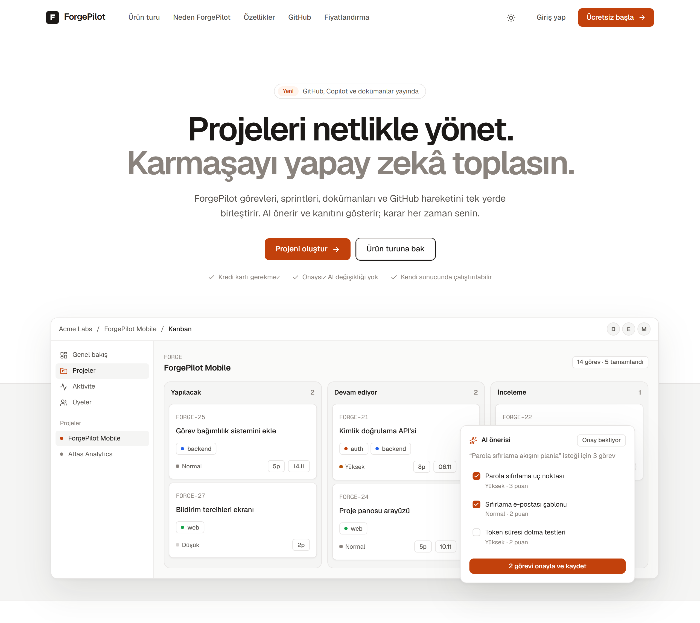
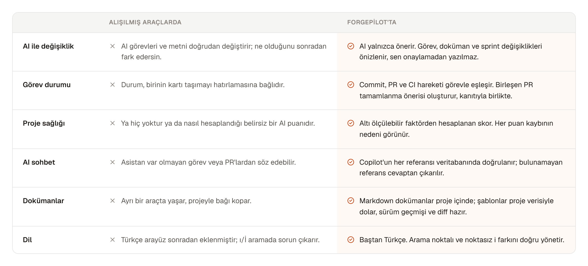
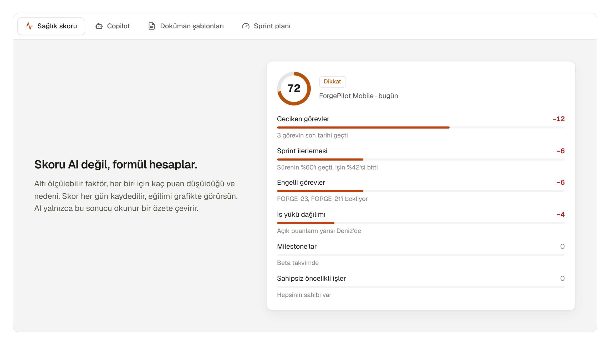
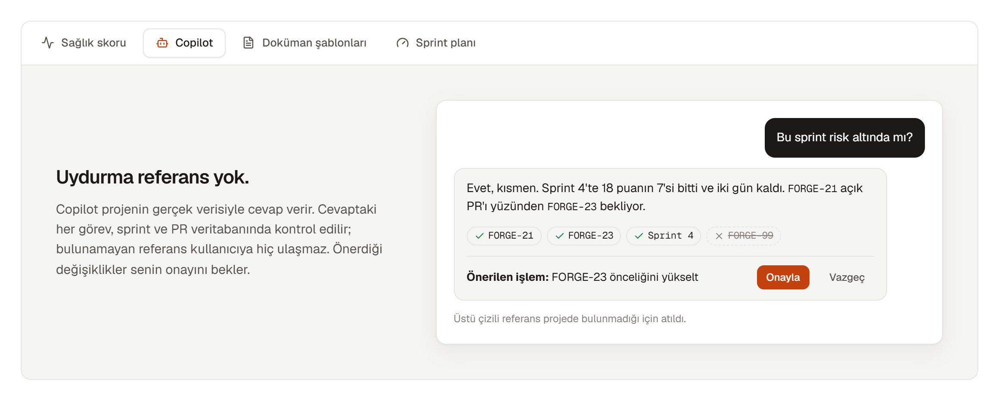
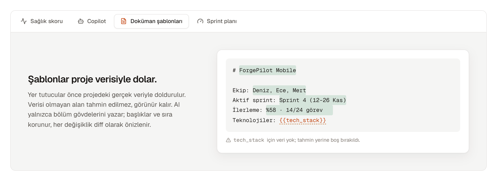
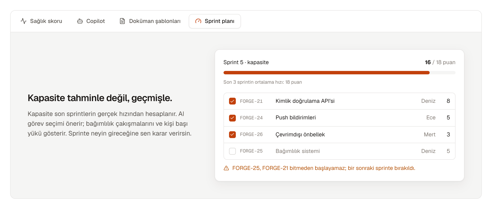
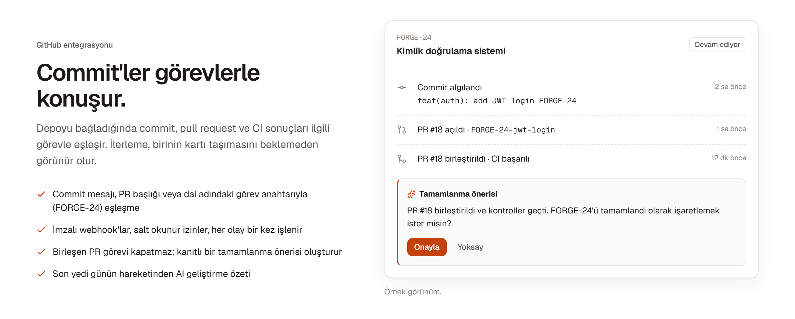
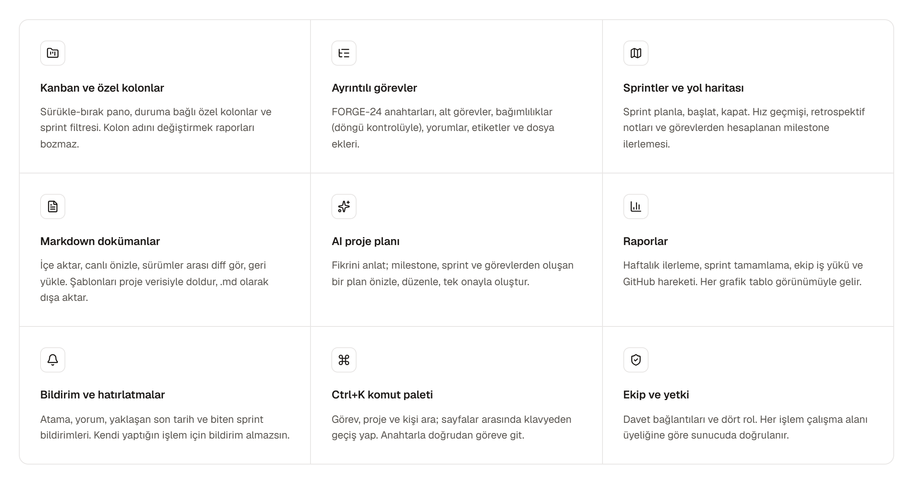

<div align="center">

# ForgePilot

**Yazılım ekipleri için yapay zekâ destekli proje yönetimi.**

Görevleri planla, sprintleri yürüt, kod hareketini görevlere bağla ve sırada ne olduğunu gör.
Yapay zekâ önerir ve kanıtını gösterir; karar her zaman senin.

[Canlı sürüm](https://forgepilot-gold.vercel.app) · [Özellikler](#özellikler) · [Kurulum](#kurulum) · [İlerleme](PROGRESS.md)


<br>

<picture>
  <source media="(prefers-color-scheme: dark)" srcset="docs/screenshots/hero-dark.png">
  
</picture>

</div>

## ForgePilot nedir?

Bir ekip birlikte yazılım geliştirirken her gün aynı sorular sorulur: *Kim neyle uğraşıyor? Şu iş bitti mi? Teslime yetişecek miyiz? Sıradaki en önemli iş ne?*

Bu soruların cevapları genelde mesajlar, notlar ve hafızalar arasında kaybolur. ForgePilot hepsini tek bir yerde toplar:

- **İşler kartlara yazılır** ve panoda "Yapılacak → Devam ediyor → Bitti" arasında taşınır.
- **Kod yazıldıkça kartlar kendiliğinden güncellenir.** GitHub'daki commit ve pull request'ler ilgili göreve bağlanır.
- **Proje sağlığı ölçülür.** Geciken, takılan ya da tek kişiye yığılan işler bir skorla görünür olur.
- **Yapay zekâ yardım eder ama kontrolü almaz.** Plan çıkarır, soru cevaplar, belge yazar; hiçbir değişiklik senin onayın olmadan kaydedilmez.

## Neden ForgePilot?

Çoğu araç işi kaydeder ve orada bırakır. ForgePilot işin gerçekte nerede olduğunu kod hareketinden, ölçülebilir verilerden ve doğrulanmış AI çıktısından çıkarır.

<picture>
  <source media="(prefers-color-scheme: dark)" srcset="docs/screenshots/why-dark.png">
  
</picture>

## Ürün turu

### Proje sağlık skoru

Skoru yapay zekâ değil, açık bir formül hesaplar. Altı ölçülebilir faktörün her biri için kaç puan düşüldüğü ve nedeni görünür; skor her gün kaydedilir.

<picture>
  <source media="(prefers-color-scheme: dark)" srcset="docs/screenshots/tour-health-dark.png">
  
</picture>

### Copilot

Projenin gerçek verisiyle cevap veren asistan. Cevaptaki her görev, sprint ve PR referansı veritabanında kontrol edilir; bulunamayan referans kullanıcıya hiç ulaşmaz. Önerdiği değişiklikler onay bekler.

<picture>
  <source media="(prefers-color-scheme: dark)" srcset="docs/screenshots/tour-copilot-dark.png">
  
</picture>

### Doküman şablonları

Markdown dokümanlar projenin içinde yaşar. Şablonlardaki yer tutucular proje verisiyle dolar; verisi olmayan alan tahmin edilmez, görünür kalır. Her sürüm saklanır ve karşılaştırılabilir.

<picture>
  <source media="(prefers-color-scheme: dark)" srcset="docs/screenshots/tour-docs-dark.png">
  
</picture>

### Sprint planlama

Kapasite tahminle değil, son sprintlerin gerçek hızıyla hesaplanır. Bağımlılık çakışmaları ve kişi başı yük gösterilir; sprinte neyin gireceğine sen karar verirsin.

<picture>
  <source media="(prefers-color-scheme: dark)" srcset="docs/screenshots/tour-sprint-dark.png">
  
</picture>

### GitHub entegrasyonu

Depo bağlandığında commit, pull request ve CI sonuçları görev anahtarıyla (ör. `FORGE-24`) eşleşir. Birleşen bir PR görevi kendiliğinden kapatmaz; kanıtıyla birlikte onay bekleyen bir tamamlanma önerisi oluşturur.

<picture>
  <source media="(prefers-color-scheme: dark)" srcset="docs/screenshots/github-dark.png">
  
</picture>

## Özellikler

<picture>
  <source media="(prefers-color-scheme: dark)" srcset="docs/screenshots/features-dark.png">
  
</picture>

| Alan | Neler var |
| --- | --- |
| **Görevler** | `FORGE-24` biçiminde anahtarlar, öncelik, atanan kişi, son tarih, puan, etiket, alt görev, bağımlılık (döngü kontrolüyle), yorum, dosya eki |
| **Kanban** | Sürükle-bırak, duruma bağlı özel kolonlar, sprint filtresi |
| **Planlama** | Sprintler (hız geçmişi, retrospektif), milestone'lar ve yol haritası |
| **Dokümanlar** | Markdown içe aktarma, canlı önizleme, sürüm geçmişi ve diff, 10 hazır şablon, `.md` dışa aktarma |
| **Yapay zekâ** | Proje planı üretici, görev önerileri, doküman yazma ve iyileştirme, Copilot, sprint önerisi, günlük özet, GitHub geliştirme özeti |
| **Analiz** | Algoritmik sağlık skoru, raporlar ve grafikler (ilerleme, sprint, iş yükü, GitHub) |
| **Ekip** | Davet bağlantıları; sahip, yönetici, üye ve izleyici rolleri; sunucu tarafı yetki kontrolü |
| **Diğer** | Bildirimler ve hatırlatmalar, Ctrl+K komut paleti, 5 adımlı kurulum sihirbazı, açık ve koyu tema |

## Güvenlik ve gizlilik

- **Onaysız değişiklik yok:** AI çıktısı önce önizlenir; kayıt, kullanıcı onayladıktan ve sunucuda yeniden doğrulandıktan sonra yapılır.
- **Yetki her istekte sunucuda kontrol edilir.** Bir kullanıcı üyesi olmadığı çalışma alanının verisini göremez.
- **GitHub salt okunur:** Uygulama depolara yazamaz. Webhook imzaları doğrulanır ve her olay bir kez işlenir. Kod içeriği saklanmaz; yalnızca commit mesajı, PR başlığı ve CI durumu tutulur.
- **Gizli anahtarlar tarayıcıya gönderilmez.** Yüklenen dosyalar sitede çalıştırılamaz.

## Teknolojiler

Next.js (App Router) · React · TypeScript · Tailwind CSS · PostgreSQL · Drizzle ORM · Better Auth · Zod · Google Gemini · BullMQ / Redis (isteğe bağlı) · remark · Recharts · dnd-kit · Framer Motion

---

## Kurulum

Gereksinimler: Node.js 22+, npm, PostgreSQL 15+. Docker isteğe bağlıdır.

```powershell
npm install
Copy-Item .env.example .env        # macOS/Linux: cp .env.example .env
# .env içinde DATABASE_URL, BETTER_AUTH_URL ve BETTER_AUTH_SECRET'ı doldur
docker compose up -d               # Docker yoksa kendi PostgreSQL'ini kullan
npm run db:migrate
npm run dev
```

Uygulama [localhost:3000](http://localhost:3000) adresinde açılır. Kayıt olduktan sonra kurulum sihirbazı seni çalışma alanı ve ilk projeye götürür.

Rastgele bir gizli değer üretmek için:

```powershell
node -e "console.log(require('node:crypto').randomBytes(32).toString('hex'))"
```

<details>
<summary><b>Örnek veri (seed)</b></summary>

<br>

Önce uygulamada kendi hesabını oluştur; seed varsayılan parola üretmez.

```powershell
$env:SEED_USER_EMAIL = "kayitli-adresin@example.com"   # macOS/Linux: export SEED_USER_EMAIL=...
npm run db:seed
```

Hesabına **"Acme Labs · Örnek"** çalışma alanı eklenir: iki proje, görevler, sprintler (biri tamamlanmış, biri aktif), milestone'lar, etiketler, bağımlılıklar, yorumlar, bir doküman ve giriş yapamayan üç örnek ekip arkadaşı. Tarihler bugüne göre hesaplanır. Komut ikinci kez çalıştırılırsa kopya oluşturmaz.

</details>

<details>
<summary><b>Vercel'e yayınlama</b></summary>

<br>

1. Barındırılan bir PostgreSQL oluştur (ör. Neon, Frankfurt bölgesi) ve migration'ları yerelden uygula: `DATABASE_URL` geçici olarak o adresi gösterirken `npm run db:migrate`.
2. Vercel'de projeyi içe aktar ve ortam değişkenlerini gir. `BETTER_AUTH_URL` sitenin adresi olmalı.
3. `vercel.json` fonksiyonları Frankfurt'ta (`fra1`) çalıştırır ve zamanlanmış işleri günde bir kez tetikler. Vercel bu isteklere `CRON_SECRET` değerini kendisi ekler.
4. Worker ve Redis gerekmez. Vercel istek gövdesini yaklaşık 4,5 MB ile sınırladığı için dosya ekleri en fazla 4 MB'tır.

</details>

<details>
<summary><b>Gemini (AI özellikleri)</b></summary>

<br>

1. [Google AI Studio](https://aistudio.google.com/)'dan bir API anahtarı al.
2. `.env` içine `GEMINI_API_KEY` yaz. İstersen `GEMINI_MODEL` ile modeli değiştir (structured output destekleyen bir model olmalı).
3. Sunucuyu yeniden başlat.

Anahtar tarayıcıya gönderilmez. Kullanım ve sınırlar **Ayarlar → AI** altında görünür. AI yapılandırılmamışsa uygulamanın geri kalanı normal çalışır.

</details>

<details>
<summary><b>GitHub App (repo erişimi ve webhook'lar)</b></summary>

<br>

1. GitHub → Settings → Developer settings → GitHub Apps → **New GitHub App**.
2. **Callback URL:** `<site>/api/github/setup`. "Request user authorization (OAuth) during installation" seçeneğini aç. Bu seçenek açıkken GitHub kurulumdan sonra bu adrese döner; Setup URL boş kalabilir.
3. **Webhook URL:** `<site>/api/github/webhook`. Güçlü bir webhook secret belirle.
4. **Repository izinleri (salt okunur):** Contents, Metadata, Pull requests, Checks.
5. **Olaylar:** Push, Pull request, Check suite, Check run.
6. Ortam değişkenlerine `GITHUB_APP_ID`, `GITHUB_APP_SLUG`, `GITHUB_APP_CLIENT_ID`, `GITHUB_APP_CLIENT_SECRET` ve `GITHUB_WEBHOOK_SECRET` değerlerini yaz. Private key şu an kullanılmıyor.

GitHub localhost'a erişemez. Yerelde webhook almak için bir tünel gerekir; yayındaki bir sitede gerekmez.

</details>

<details>
<summary><b>Sosyal giriş (Google, GitHub)</b></summary>

<br>

`GOOGLE_CLIENT_ID` / `GOOGLE_CLIENT_SECRET` ve `GITHUB_CLIENT_ID` / `GITHUB_CLIENT_SECRET` tanımla. Geri dönüş adresleri `<site>/api/auth/callback/google` ve `<site>/api/auth/callback/github`. GitHub ile giriş, GitHub App'ten ayrıdır.

</details>

<details>
<summary><b>Redis ve zamanlanmış işler</b></summary>

<br>

Redis olmadan işler istek sırasında çalışır. Kuyruk kullanmak için:

```powershell
docker compose --profile queue up -d
# .env: REDIS_URL=redis://localhost:6379
npm run worker
```

Worker; son tarih ve gecikme hatırlatmalarını, biten sprint bildirimlerini, günlük sağlık skoru kaydını ve başarısız GitHub olaylarının yeniden denenmesini yapar. Redis kullanılmıyorsa aynı işler `CRON_SECRET` ile korunan `/api/cron/<iş>` ucundan tetiklenir: `reminders.due`, `reminders.sprint`, `health.snapshot`, `github.retry`.

```http
GET /api/cron/reminders.due
Authorization: Bearer <CRON_SECRET>
```

</details>

<details>
<summary><b>Ortam değişkenleri</b></summary>

<br>

| Değişken | Gerekli | Kullanım |
| --- | --- | --- |
| `DATABASE_URL` | evet | PostgreSQL bağlantısı |
| `BETTER_AUTH_SECRET` | evet | En az 32 karakter rastgele değer |
| `BETTER_AUTH_URL` | evet | Uygulamanın adresi, ör. `http://localhost:3000` |
| `GEMINI_API_KEY`, `GEMINI_MODEL` | hayır | AI özellikleri |
| `GOOGLE_CLIENT_ID`, `GOOGLE_CLIENT_SECRET` | hayır | Google ile giriş |
| `GITHUB_CLIENT_ID`, `GITHUB_CLIENT_SECRET` | hayır | GitHub ile giriş |
| `GITHUB_APP_ID`, `GITHUB_APP_SLUG`, `GITHUB_APP_CLIENT_ID`, `GITHUB_APP_CLIENT_SECRET`, `GITHUB_WEBHOOK_SECRET` | hayır | GitHub entegrasyonu |
| `REDIS_URL` | hayır | BullMQ kuyruğu ve worker |
| `CRON_SECRET` | hayır | `/api/cron/<iş>` ucunu korur |
| `SEED_USER_EMAIL` | yalnızca seed | Örnek verinin ekleneceği kayıtlı hesap |

</details>

<details>
<summary><b>Mimari</b></summary>

<br>

```txt
src/
  app/                  Sayfalar (App Router) ve API uçları (webhook, cron, ekler, dışa aktarma)
  components/           Ortak arayüz bileşenleri
  features/             Alan bazlı istemci bileşenleri ve saf mantık
  lib/                  İstemci ve sunucuda ortak yardımcılar
  server/               Yalnızca sunucuda çalışan kod
    db/                 Drizzle şeması ve bağlantı
    ai/                 AIProvider arayüzü, Gemini uygulaması, kota
    github/             Webhook işleme, kurulum doğrulama, eşleme
    jobs/               Kuyruk ve zamanlanmış işler
drizzle/                SQL migration'ları
scripts/                migrate, seed, worker
```

- Tüm kalıcı veri PostgreSQL'de. İstemciden gelen `workspaceId` / `projectId` değerlerine güvenilmez; üyelik her çağrıda doğrulanır.
- Sunucu işlemleri `{ ok, error }` döndürür. Kullanıcıya yönelik hatalar üretimde de görünür, beklenmeyen hatalar sızmaz.
- AI çıktısı Zod ile doğrulanır. AI'ın uydurduğu görev, PR veya sprint referansları sunucuda elenir. Her AI çağrısı kaydedilir ve kullanıcı başına saatlik sınırlar uygulanır.
- Markdown ayrıştırma deterministiktir (remark). AI dokümanlarda yalnızca bölüm gövdelerini yazar; başlıklar ve sıra korunur.

</details>

### Komutlar

| Komut | Ne yapar |
| --- | --- |
| `npm run dev` | Geliştirme sunucusu |
| `npm run build` / `npm start` | Üretim derlemesi ve sunucusu |
| `npm run typecheck` | TypeScript kontrolü |
| `npm run db:generate` | Şemadan migration üretir |
| `npm run db:migrate` | Migration'ları uygular |
| `npm run db:seed` | Örnek veriyi ekler |
| `npm run worker` | Kuyruk worker'ı (`REDIS_URL` gerekir) |

## Yol haritası

- [ ] Parola sıfırlama ve e-posta doğrulama (e-posta gönderimi)
- [ ] Yorumlarda @bahsetme
- [ ] Ödeme altyapısı ve ücretli planlar
- [ ] Mobil görünüm ve erişilebilirlik iyileştirmeleri

Ayrıntılı ilerleme: [PROGRESS.md](PROGRESS.md)

<div align="center">
<br>
<sub>ForgePilot · Erken sürüm · Aktif geliştirme</sub>
</div>
